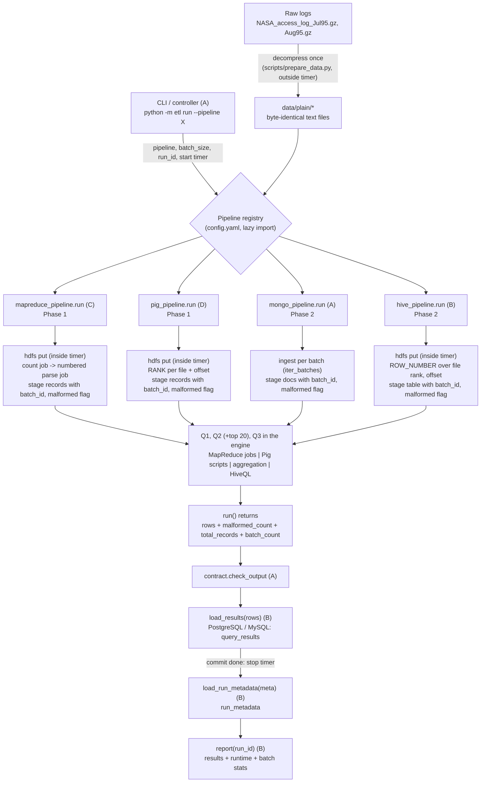

# Architecture

Four execution choices behind one interface. **Phase 1: MapReduce + Pig** (shared Hadoop environment). **Phase 2: MongoDB + Hive.**

## End-to-end workflow



Seven steps, who owns each:

| # | Step | Owner |
|---|---|---|
| 1 | Pick pipeline, batch size, run id, start timer | A |
| 2 | Copy input into the engine, number lines, parse, batch (same contract for every engine) | pipeline owner, rules by B |
| 3 | Stage structured records (HDFS files / Mongo collection / Hive table) | pipeline owner |
| 4 | Run Q1, Q2, Q3 over the staged data | pipeline owner |
| 5 | Result rows: `pipeline, run_id, batch_id, executed_at` | pipeline owner |
| 6 | Load into the relational DB (+ run metadata) | B (called by A) |
| 7 | Report from the DB | B (called by A) |

Pipeline owners: MapReduce = C, Pig = D, MongoDB = A, Hive = B. D also owns the Hadoop environment.

## Design decisions (for Phase 1 discussion and the final report)

1. **Pipeline = one function.** `run(input_files, batch_size, run_id) -> dict`. The controller never knows engine internals, so switching backend is a config/CLI change only.
2. **Batching.** `batch_id = (line_number - 1) // batch_size + 1`, line numbers global across Jul95 then Aug95, malformed lines keep their number. Batches are an ingest/staging concept: every staged record carries its `batch_id`. Each engine obtains line numbers differently (MapReduce: two-pass; Pig: `RANK` + offset; Mongo: `iter_batches`; Hive: `ROW_NUMBER`), and all must agree.
3. **Queries are global over staged data.** Distinct counts (Q2 `distinct_host_count`, Q3 `distinct_error_hosts`) cannot be merged from per-batch results, so aggregating per batch and merging would be wrong. Result rows carry `batch_id = batch_count` (decision D1, to be confirmed with the instructor).
4. **Fair comparison.** Same input bytes (manifest sha256), same batch size, same parsing contract, same output columns, same split size on Hadoop. `python -m etl compare` proves two runs are equivalent row by row.
5. **Runtime** = just before the pipeline reads input until `query_results` is committed. Includes copying the input into the engine (HDFS put / Mongo ingest). Excludes download, install, container start-up, decompression, run-metadata write and report rendering.
6. **No silent drops.** Malformed lines are counted in `malformed_count` and `total_records`.
7. **One line-terminator rule.** A line ends at `\n` only; Hadoop engines set `textinputformat.record.delimiter` accordingly (or the files are proven free of lone `\r`).
8. **Safety net.** Every run is validated by `etl.contract` before anything is loaded (a pipeline that breaks the contract loads nothing). If the Hadoop environment is not usable in time, MongoDB (A) is built early enough to replace a Phase 1 pipeline in the demo.

## Relational schema (owned by B, shape agreed)

```
query_results(pipeline, run_id, batch_id, query_id, executed_at,
              log_date, status_code, request_count, total_bytes,          -- Q1
              resource_path, distinct_host_count,                         -- Q2 (+ request_count, total_bytes)
              log_hour, error_request_count, total_request_count,
              error_rate, distinct_error_hosts)                           -- Q3
run_metadata(run_id, pipeline, runtime_sec, batch_size, batch_count,
             total_records, avg_batch_size, malformed_count)
```

## Diagram for slides

Use the flowchart above (paste the mermaid block into <https://mermaid.live> and export as PNG/SVG), or the ASCII version:

```
Raw .gz logs (Jul95, Aug95)
   |  decompress once (outside timer)
   v
[1] Controller / CLI (A)  -- pipeline, batch size, run_id, start timer
   v
[2] Copy into engine + number lines + parse + batch
      Phase 1: MapReduce (C) | Pig (D) on Hadoop     Phase 2: MongoDB (A) | Hive (B)
      rules from B's contract; HDFS put / Mongo ingest counted in runtime
   v
[3] Stage structured records with batch_id (HDFS files / Mongo collection / Hive table)
   v
[4] Q1, Q2, Q3 in the engine (MapReduce jobs | Pig | aggregation | HiveQL)
   v
[5] Result rows: pipeline, run_id, batch_id, executed_at   -> contract check (A)
   v
[6] Loader (B) -> PostgreSQL/MySQL: query_results, then run_metadata   (timer stops after query_results)
   v
[7] Report (B): results + pipeline, query name, runtime, batch ID, batch size, avg batch size
```
